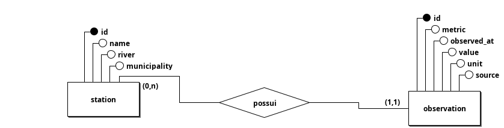
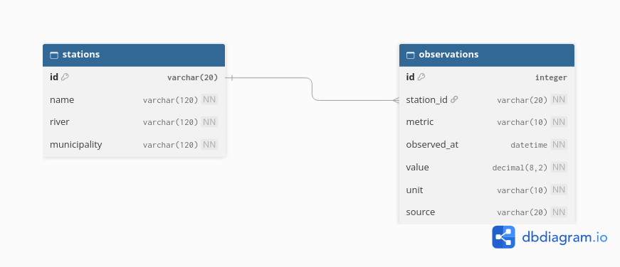

# API de Monitoramento Hidrológico | Desafio COGMO

API REST em **Python + Django** que simula o monitoramento de rios e chuvas em estações fictícias. Ela lista as estações, entrega um resumo com as últimas leituras e devolve o histórico de **nível do rio** e de **chuva**, a partir de dados sintéticos.

> **Atenção:** todos os dados são **simulados**. Não representam rios reais e não devem ser usados para alertas ou decisões. Toda resposta da API, inclusive de erro, traz `"simulated": true`.

Projeto feito por um grupo de três pessoas para o desafio da COGMO Technology. Esta versão cobre **somente o backend**, adaptado do desafio original (Node.js, Express e SQLite) para Python e Django.

## Tecnologias

| Tecnologia | Para que serve |
|---|---|
| Python 3 | linguagem do projeto |
| Django | framework web, ORM e migrations |
| Django REST Framework | construção da API REST |
| drf-spectacular | documentação automática (Swagger e Redoc) |
| django-cors-headers | liberar CORS para um frontend consumir a API |
| SQLite | banco de dados local, sem instalação extra |

## Endpoints

| Método | Rota | O que devolve |
|---|---|---|
| GET | `/api/stations` | lista das estações |
| GET | `/api/stations/{id}/summary` | estação e última leitura de nível e de chuva |
| GET | `/api/stations/{id}/series?metric=level&hours=24` | histórico de nível, em metros |
| GET | `/api/stations/{id}/series?metric=rain&hours=24` | histórico de chuva, em mm/h |

Estações do seed: `EST-01`, `EST-02` e `EST-03`.

## Como rodar

**Pré-requisitos:** Python 3.10 ou superior e Git.

**1. Criar e ativar o ambiente virtual**

```bash
python3 -m venv .venv
source .venv/bin/activate
```

No Windows (PowerShell), ative com `.venv\Scripts\Activate.ps1`. Quando o ambiente está ativo, aparece `(.venv)` no começo da linha do terminal.

**2. Instalar os pacotes**

```bash
pip install -r requirements.txt
```

**3. Criar o banco**

```bash
python manage.py migrate
```

**4. Gerar e importar os dados simulados**

```bash
python scripts/generate_seed.py
python manage.py import_observations
```

Esperado: `3 estações; 438 observações novas`. Rodar a importação de novo mostra `0 observações novas`.

**5. Subir o servidor**

```bash
python manage.py runserver
```

O servidor fica em `http://127.0.0.1:8000/`. A raiz não tem página: use os endereços da próxima seção.

## Documentação da API

| O quê | Endereço |
|---|---|
| Swagger (testa as rotas com o **Try it out**) | http://127.0.0.1:8000/api/docs |
| Redoc (leitura) | http://127.0.0.1:8000/api/redoc |
| Schema OpenAPI | http://127.0.0.1:8000/api/schema |
| Contrato em texto | [docs/api-contract.md](docs/api-contract.md) |
| Painel de administração | http://127.0.0.1:8000/admin/ (com a barra final) |

Para entrar no painel de administração, crie um usuário com `python manage.py createsuperuser`.

## Respostas e erros

Exemplo: `GET /api/stations/EST-01/series?metric=level&hours=3`

```json
{
  "simulated": true,
  "disclaimer": "Dados simulados para fins didáticos. Não representam rios reais nem devem embasar alertas ou decisões.",
  "station_id": "EST-01",
  "metric": "level",
  "unit": "m",
  "hours": 3,
  "from": "2026-11-02T19:00:00Z",
  "to": "2026-11-02T22:00:00Z",
  "count": 4,
  "data": [
    { "observed_at": "2026-11-02T19:00:00Z", "value": 1.13 },
    { "observed_at": "2026-11-02T20:00:00Z", "value": 1.13 }
  ]
}
```

Os parâmetros da série são `metric` (obrigatório: `level` ou `rain`) e `hours` (opcional, de 1 a 72, padrão 24). A janela termina na última leitura da estação e inclui as duas pontas, por isso `hours=3` devolve 4 pontos.

Todo erro segue o mesmo formato:

```json
{ "simulated": true, "error": "invalid_metric", "message": "O parâmetro 'metric' é obrigatório e deve ser 'level' ou 'rain'." }
```

| Situação | Status | `error` |
|---|---|---|
| Estação não existe | 404 | `station_not_found` |
| `metric` ausente ou inválida | 400 | `invalid_metric` |
| `hours` fora de 1 a 72 ou não numérico | 400 | `invalid_hours` |
| Rota inexistente sob `/api/` | 404 | `not_found` |
| Método diferente de GET | 405 | `method_not_allowed` |

## Modelo de dados

O banco tem duas tabelas, que seguem a estrutura do `seed.js` original: `stations` (estações) e `observations` (leituras).

### MER (modelo conceitual)



Uma estação **possui** várias observações, e cada observação pertence a exatamente uma estação (relacionamento 1:N).

### DER (modelo lógico)



**stations**

| Campo | Tipo | Descrição |
|---|---|---|
| `id` | texto (PK) | código da estação, ex: `EST-01` |
| `name` | texto | nome da estação |
| `river` | texto | nome do rio |
| `municipality` | texto | município |

**observations**

| Campo | Tipo | Descrição |
|---|---|---|
| `id` | inteiro (PK) | identificador gerado automaticamente |
| `station_id` | texto (FK) | referência a `stations.id` |
| `metric` | texto | `level` (nível) ou `rain` (chuva) |
| `observed_at` | data e hora (UTC) | horário da leitura |
| `value` | decimal | valor na unidade da métrica |
| `unit` | texto | `m` (metros) ou `mm/h` (milímetros por hora) |
| `source` | texto | origem do dado (`synthetic`) |

### Decisões do modelo

- **Duas tabelas em vez de uma:** os dados da estação (nome, rio, município) são guardados uma única vez. As observações apenas referenciam a estação pela chave estrangeira, evitando repetir as mesmas informações em centenas de linhas.
- **Métrica como coluna:** nível e chuva ficam na mesma tabela, diferenciados pela coluna `metric` e acompanhados da `unit`. Isso segue o `seed.js` original e permite incluir novas métricas sem alterar a estrutura.
- **Restrição de unicidade:** a combinação (`station_id`, `metric`, `observed_at`) é única. Assim, rodar a importação mais de uma vez não duplica leituras, e o seed é repetível.
- **Integridade referencial:** toda observação precisa apontar para uma estação existente. Se uma estação for removida, suas observações são removidas junto (`ON DELETE CASCADE`).
- **Horários em UTC:** todas as datas são armazenadas em UTC, conforme o contrato da API.

### Dados sintéticos (seed)

Os dados são gerados em duas etapas:

1. `python scripts/generate_seed.py` gera `data/stations.csv` (3 estações) e `data/observations.csv` (438 leituras: 3 estações × 2 métricas × 73 horários).
2. `python manage.py import_observations` lê os CSVs e grava no banco. Pode ser executado várias vezes sem duplicar registros.

Todos os dados são simulados e não representam rios reais.

Os valores vêm das mesmas fórmulas do `seed.js` (seno para o nível, resto de divisão para a chuva), sem números aleatórios, então são reproduzíveis. Por padrão, o último horário é a hora cheia atual em UTC. Para fixá-lo, use `python scripts/generate_seed.py --end 2026-11-02T22:00:00Z`.


## Regras do projeto

- **UTC:** datas em ISO 8601 com `Z` no final (ex: `2026-11-02T10:00:00Z`).
- **Unidades:** nível em `m` e chuva em `mm/h`, sempre informadas na resposta.
- **Nível e chuva não se misturam:** `metric` é obrigatório e a consulta filtra por ele.
- **Lacunas:** a API nunca inventa leituras. Horário sem leitura não aparece; série sem dados devolve 200 com `count: 0` e `data: []`.
- **Consultas seguras:** acesso ao banco pelo ORM do Django, que usa consultas parametrizadas.


## Próximos passos

- Interface web com gráficos separados de nível e chuva, consumindo esta API (o CORS já está configurado).
- Mais testes de casos extremos e filtro por intervalo de datas.

Ficam fora do escopo: previsão por IA, alertas de risco, sensores reais, autenticação e deploy.
- [Contrato completo da API](docs/api-contract.md)
- [Diagrama de entidade-relacionamento](docs/DER.png)
- [Modelo entidade-relacionamento](docs/MER.png)
