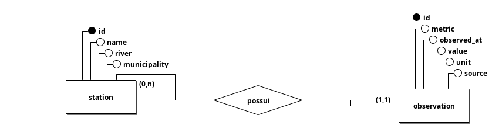
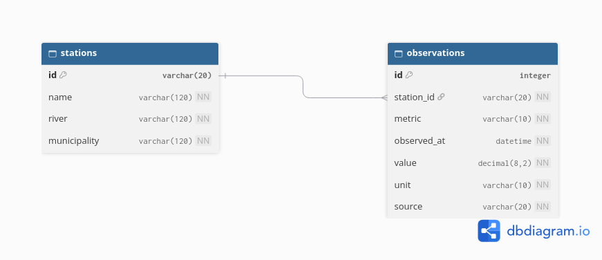

# API de Monitoramento Hidrológico | Desafio COGMO

## Modelo de dados

O banco tem duas tabelas, que seguem a estrutura do `seed.js` original: `stations` (estações) e `observations` (leituras).

### MER (modelo conceitual)



Uma estação **possui** várias observações, e cada observação pertence a exatamente uma estação (relacionamento 1:N).

### DER (modelo lógico)



**stations**

| Campo | Tipo | Descrição |
|---|---|---|
| `id` | texto (PK) | código da estação, ex: `EST-01` |
| `name` | texto | nome da estação |
| `river` | texto | nome do rio |
| `municipality` | texto | município |

**observations**

| Campo | Tipo | Descrição |
|---|---|---|
| `id` | inteiro (PK) | identificador gerado automaticamente |
| `station_id` | texto (FK) | referência a `stations.id` |
| `metric` | texto | `level` (nível) ou `rain` (chuva) |
| `observed_at` | data e hora (UTC) | horário da leitura |
| `value` | decimal | valor na unidade da métrica |
| `unit` | texto | `m` (metros) ou `mm/h` (milímetros por hora) |
| `source` | texto | origem do dado (`synthetic`) |

### Decisões do modelo

- **Duas tabelas em vez de uma:** os dados da estação (nome, rio, município) são guardados uma única vez. As observações apenas referenciam a estação pela chave estrangeira, evitando repetir as mesmas informações em centenas de linhas.
- **Métrica como coluna:** nível e chuva ficam na mesma tabela, diferenciados pela coluna `metric` e acompanhados da `unit`. Isso segue o `seed.js` original e permite incluir novas métricas sem alterar a estrutura.
- **Restrição de unicidade:** a combinação (`station_id`, `metric`, `observed_at`) é única. Assim, rodar a importação mais de uma vez não duplica leituras, e o seed é repetível.
- **Integridade referencial:** toda observação precisa apontar para uma estação existente. Se uma estação for removida, suas observações são removidas junto (`ON DELETE CASCADE`).
- **Horários em UTC:** todas as datas são armazenadas em UTC, conforme o contrato da API.

### Dados sintéticos (seed)

Os dados são gerados em duas etapas:

1. `python scripts/generate_seed.py` gera `data/stations.csv` (3 estações) e `data/observations.csv` (438 leituras: 3 estações × 2 métricas × 73 horários).
2. `python manage.py import_observations` lê os CSVs e grava no banco. Pode ser executado várias vezes sem duplicar registros.

---

## 🚀 Como Executar o Projeto

Siga os passos abaixo para configurar o ambiente e rodar a API na sua máquina:

### 1. Criar e Ativar o Ambiente Virtual (`venv`)
> [!NOTE]
> Certifique-se de estar com o terminal PowerShell aberto na raiz do projeto clonado.

```powershell
python -m venv venv
.\venv\Scripts\Activate
2. Instalar as Dependências
Com o ambiente virtual ativado (venv), instale os pacotes necessários:

pip install -r requirements.txt

3. Configurar o Banco de Dados e Popular (Seed)
Execute as migrações e importe os dados sintéticos do arquivo CSV:

python manage.py migrate
python scripts/generate_seed.py
python manage.py import_observations

Como Rodar o Servidor Local
Inicie o servidor de desenvolvimento do Django:

python manage.py runserver

📚 Documentação da API
Você pode testar e consultar os endpoints da API através da documentação interativa gerada pelo Swagger:

🟢 Swagger UI (Interativo): http://127.0.0.1:8000/api/docs

🔵 Principais Endpoints (GET):

/api/stations — Lista todas as estações.

/api/stations/{id}/summary — Exibe o resumo estatístico.

/api/stations/{id}/series — Exibe a série temporal de medições.


Todos os dados são simulados e não representam rios reais.
